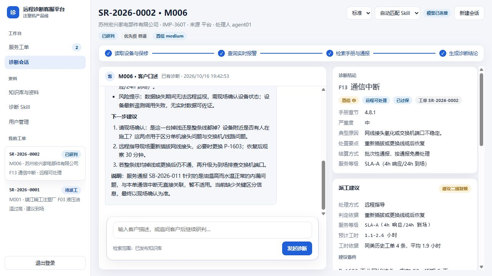

# 设备厂商远程诊断客服平台

面向工业设备制造商的对话式远程诊断与服务体系。首个落地产品线为注塑机
IMP 系列，把设备档案、保修合同、故障树、服务通报、历史工单、备件与设备
实时数据整合到一次问答里，输出**有依据、有边界、可审计**的初步诊断。



## 目录

```text
zuoye/
  app/                产品代码（后端、前端、文档、部署脚本）
  remotediag/         诊断数据集与 MCP 只读工具服务
  厂商远程诊断客服平台PRD.md   产品需求文档
```

`remotediag/` 是本项目的组成部分：它提供初始数据集和工具服务，产品后端通过
进程与配置连接，不直接读取数据文件。

## 快速开始

```powershell
cd D:\shixi\zuoye\app
.\start-background.ps1          # 后台启动，停用见 .\stop-background.ps1
```

访问 `http://127.0.0.1:8091`。开发时想直接看日志用 `.\start.ps1`（前台）。

> 端口说明：本项目默认使用 8091。`C:\Users\honor\Desktop\zuoye` 下的风电场项目
> 保留在 8090，两个项目可同时运行，互不影响。

初始账号（首次登录需改密码）：

```text
admin   / admin_change_me    系统管理员
agent01 / agent_demo_2026    客服工程师
tech01  / tech_demo_2026     技术支持工程师
cust01  / cust_demo_2026     客户联系人（绑定镇江精工注塑厂）
```

## 更多说明

- 应用结构与启动：[app/README.md](app/README.md)
- 系统使用说明（交付客户的操作手册）：[app/docs/usage.md](app/docs/usage.md)
- 架构与接口：[app/docs/architecture.md](app/docs/architecture.md)、[app/docs/api.md](app/docs/api.md)
- 数据存储与迁移：[app/docs/database.md](app/docs/database.md)
- 诊断评测：[app/docs/evaluation.md](app/docs/evaluation.md)
- 诊断数据集与工具服务：[remotediag/README.md](remotediag/README.md)
